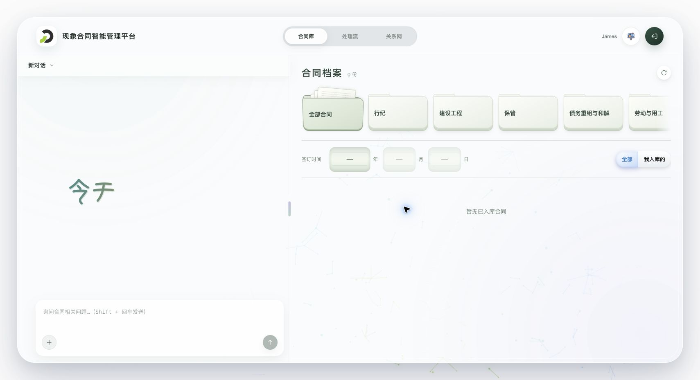
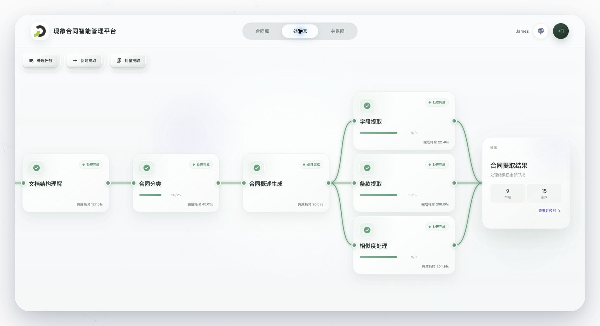
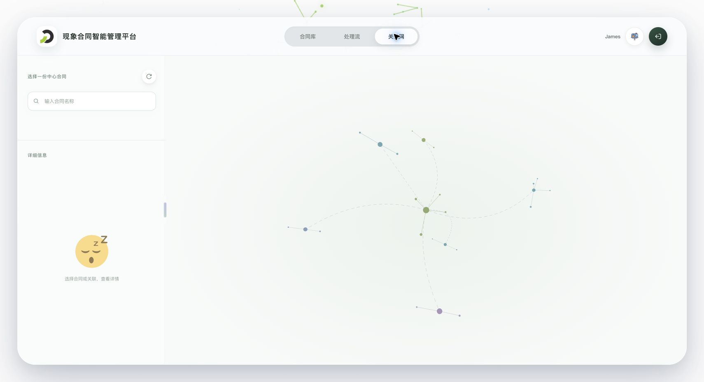

# 现象合同智能管理平台前端

基于 Vue 3 的合同管理工作台，覆盖合同上传与提取、人工校对与送审、正式合同管理、智能问答和三维关联探索。前端已接入登录鉴权、真实业务接口与 SSE 任务事件；合同处理、审核和正式存储由后端负责。

## 关键功能

| 模块 | 功能 | 详细说明 |
| --- | --- | --- |
| 合同库 | 类别、签订日期和上传人筛选；PDF 阅读、缩放、摘要、注意事项和合同关联；提交删除审核申请 | [合同库](description/features/contract-library.md) |
| 智能助手 | 流式问答与执行过程展示、会话历史、附件上传与预览、引用正式合同；自动重连与模块切换状态保留 | [会话交互](description/features/agent-conversation.md) |
| 处理流 | 单份与批量提取、重复性判断、分类与概述生成、Core 字段和条款校对、提交入库审核申请 | [处理流](description/features/contract-ingestion.md) |
| 关系网 | 搜索中心合同、查看一跳无向关联；三维分子节点、动态切换中心、合同摘要与关联详情 | [合同关系网](description/features/contract-network.md) |
| 审核信箱 | 工作台全局入口；入库与删除审核记录、我的入库申请筛选、发送与执行状态、PDF 预览、清理倒计时 | [审核日志](description/features/contract-ingestion.md#审核日志) |

提交入库或删除申请成功只表示申请已保存，审核通过与实际入库、删除分别展示。PDF、附件、合同关联等读取结果按各自规则在当前页面内存中缓存，具体失效和容量边界见对应专题文档。

## 实机演示

以下图片于 **2026-10-10** 从实际运行的浏览器页面截取。拍摄时正式合同库为空，关系网处于待机状态；处理流展示已完成任务，审核信箱展示实际等待审核的申请。

### 合同库与智能助手

左侧为会话区域，支持附件和合同引用；右侧为合同档案，按类别、签订日期及上传人组合筛选。左右栏宽度可调整。下图展示空档案状态。



### 合同处理流

通过节点展示提取阶段、进度与耗时，字段提取、条款提取和相似度处理汇聚到最终结果。完成后可核对名称、摘要、备注、核心字段和条款，再提交审核。下图展示实际已完成任务的结果汇聚区域。



### 三维合同关系网

左侧选择中心合同并查看合同或关联详情，右侧展示基于 `3d-force-graph` 的三维关系网。选择关联节点后可切换中心继续探索；未选择合同时显示自动旋转的分子待机画面。



### 审核信箱

用户名右侧的信箱按钮打开审核日志，支持入库审核与删除审核切换。入库申请可按“全部 / 我提交的”筛选，详情分别展示发送、审核和实际执行状态。下图截取弹窗顶部的列表与状态区域，未纳入合同正文或完整摘要。


## 技术组成

- Vue 3、Vue Router：工作台组件、页面路由与状态保留。
- PDF.js：合同阅读、页数与封面、文本层及缩放交互。
- Three.js、3d-force-graph：三维合同关系网。
- Markdown-it：智能助手回复排版。
- Vite、Nginx、Docker：开发构建、静态资源与 API/SSE 转发。

## 本地开发

使用 Node.js 24（与 Docker 构建环境一致），安装锁文件中的依赖：

```bash
npm ci
```

启动开发服务器：

```bash
npm run dev
```

开发服务器固定监听 `0.0.0.0:20080`；端口被占用时直接启动失败。当前开发基础路径为 `/dev/contract/`，页面包括 `/dev/contract/library`、`/dev/contract/ingestion` 和 `/dev/contract/network`。

完整联调需要已运行的后端及项目约定的 Nginx 入口。API 请求依赖网关去除 `/dev` 前缀，再通过 `/contract/api` 转发；不能仅凭 Vite 端口可访问就认为接口已经连通。后端地址与路径规则见 [登录与鉴权](description/platform/authentication.md)和[路由与部署要求](description/platform/routing.md)。登录使用后端配置的用户密钥，免登码随受保护请求作为 Bearer 凭据发送，不在仓库中保存密钥或令牌。

## PDF.js 运行时资源

项目使用 PDF.js 阅读合同并读取页数和封面。`dev` 和 `build` 命令执行前会自动运行：

```bash
npm run sync:pdfjs-assets
```

该命令从当前安装的 `pdfjs-dist` 同步 CMap、标准字体和 WASM 资源到 `public/pdfjs/`。该目录由脚本生成且不纳入版本控制；Vite 构建时会将其复制到 `dist/pdfjs/`。

## 生产构建

执行：

```bash
npm run build
```

构建产物输出到 `dist/`。部署时需保留完整目录，包括 `dist/pdfjs/` 中的 PDF.js 运行时资源。生产基础路径、History 路由回退及 SSE 转发需与网关一致；容器构建使用 `/contract/` 作为基础路径。

## Docker 部署

根目录 `Dockerfile` 构建前端静态资源并使用 Nginx 提供页面及后端转发，不包含后端、数据库或模型服务。

```bash
docker build -t contract-service-fe:local .
```

容器默认后端地址为 `contract-service:20000`，通过 `BACKEND_UPSTREAM` 配置。运行示例、宿主机与容器网络、图标缓存和联调检查见 [Docker 部署](description/platform/docker.md)。

## 项目文档

- 开发规范见 [`AGENTS.md`](AGENTS.md)。
- 项目原则与前端边界见 [`description/project.md`](description/project.md)。
- 文档导航见 [`description/readme.md`](description/readme.md)。
